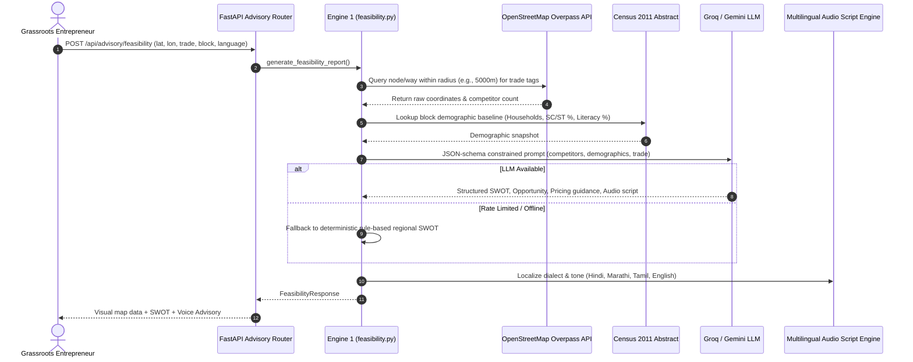
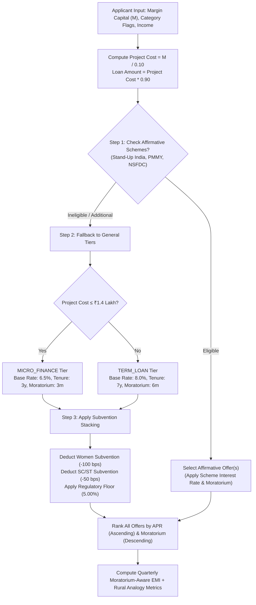
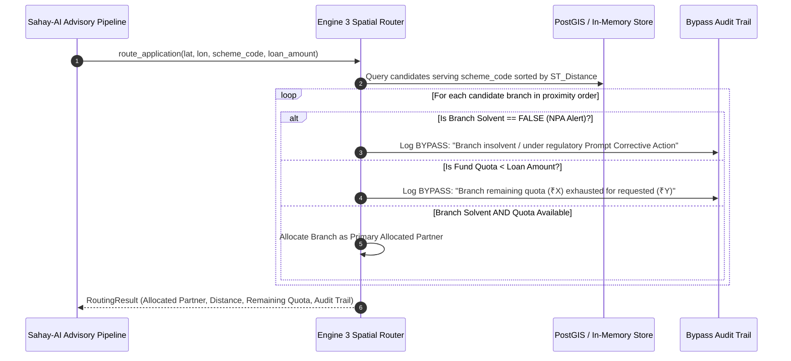
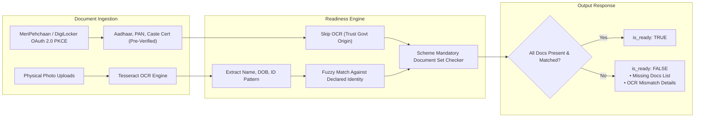

# Sahay-AI System Architecture & Technical Specifications

**AI-Powered Hyper-Local Business Advisory & Sovereign Credit Navigation for Grassroots Entrepreneurs**  
*Aligned with Smart India Hackathon Problem Statements: SIH26091 (Business Advisory) & SIH26092 (Credit Navigation)*

---

## 1. Architectural Philosophy & Overview

Rural micro-entrepreneurs in India face two compounding barriers to economic mobility:
1. **The Feasibility Blindspot:** Lack of hyper-local market intelligence leads to high failure rates from hyper-local competition and misalignment with local demographics.
2. **The Credit Navigation Chasm:** Complex government schemes, confusing documentation barriers, and non-transparent bank routing cause eligible entrepreneurs to either abandon applications or get rejected by branches with exhausted quotas or NPA locks.

**Sahay-AI** resolves this through a coordinated multi-engine pipeline:

```mermaid
flowchart TD
    subgraph Frontend["Frontend Client (Next.js 14 App Router)"]
        UI_Home["Landing Page /"]
        UI_Advisor["Business Advisor /business-advisor"]
        UI_Matcher["Scheme Matcher /scheme-matcher"]
        UI_Comp["Grassroots Companion /companion"]
        UI_Slip["Printable Bank Manager Slip"]
        UI_Voice["Bhashini / Web Speech Voice TTS"]
    end

    subgraph API_Gateway["FastAPI Gateway (Port 8000)"]
        R_Root["/health & Docs"]
        R_Feas["/api/advisory/feasibility"]
        R_Match["/api/schemes/match"]
        R_EMI["/api/schemes/match/{code}/emi"]
        R_Digi["/api/schemes/digilocker/*"]
        R_Doc["/api/schemes/document-readiness"]
        R_Full["/api/advisory/full-report"]
    end

    subgraph Engine1["Engine 1: Hyper-Local Feasibility & SWOT"]
        OSM["OpenStreetMap Overpass API (Live Density)"]
        Census["RGI Census 2011 Primary Abstract (PCA)"]
        LLM["Groq (GPT-OSS) / Google Gemini 2.5 Flash"]
        Fall_SWOT["Rule-Based Feasibility Fallback"]
    end

    subgraph Engine2["Engine 2: Mathematical Financier"]
        Margin["Fixed 10% Margin Multiplier"]
        Tier["Tier Classifier (Micro < ₹1.4L vs Term ≤ ₹50L)"]
        Affirm["Affirmative Scheme Matrix (PMMY, Stand-Up, NSFDC)"]
        Subv["Subvention Stacking (Women 100 bps, SC/ST 50 bps)"]
        EMI_Calc["Quarterly Reducing-Balance EMI + Harvest Metrics"]
    end

    subgraph Engine3["Engine 3: Channel Partner Spatial Router"]
        PostGIS["PostgreSQL + PostGIS (ST_Distance Point Index)"]
        InMem["In-Memory Spatial Fallback (Haversine)"]
        Solv["Branch Solvency & NPA Filter"]
        Quota["Fund Quota Availability Guard"]
        Audit["Transparent Bypass Audit Logger"]
    end

    subgraph Sub_Doc["Verification & DigiLocker Subsystem"]
        MeriPehchaan["MeriPehchaan / DigiLocker OAuth 2.0 PKCE"]
        OCR["Tesseract OCR Field Extractor (PyTesseract)"]
        Fuzzy["Declared Identity Cross-Matcher"]
    end

    %% Wiring
    UI_Advisor --> R_Feas
    UI_Matcher --> R_Match
    UI_Matcher --> R_EMI
    UI_Matcher --> R_Digi
    UI_Matcher --> R_Doc
    UI_Comp --> R_Full

    R_Feas --> Engine1
    R_Match --> Engine2
    R_EMI --> Engine2
    R_Digi --> Sub_Doc
    R_Doc --> Sub_Doc
    R_Full --> Engine1
    R_Full --> Engine2
    R_Full --> Engine3
    R_Full --> Sub_Doc

    Engine1 --- OSM
    Engine1 --- Census
    Engine1 --- LLM
    Engine1 --- Fall_SWOT

    Engine2 --- Margin
    Engine2 --- Tier
    Engine2 --- Affirm
    Engine2 --- Subv
    Engine2 --- EMI_Calc

    Engine3 --- PostGIS
    Engine3 --- InMem
    Engine3 --- Solv
    Engine3 --- Quota
    Engine3 --- Audit

    Sub_Doc --- MeriPehchaan
    Sub_Doc --- OCR
    Sub_Doc --- Fuzzy
```



---

## 2. Core Engine Breakdown

### Engine 1: Hyper-Local Feasibility & SWOT Grounding (`backend/engine/feasibility.py`)

Engine 1 replaces generic AI hallucinations with verifiable, hyper-local data grounding:



#### Grounding Mechanisms:
1. **OpenStreetMap Overpass Querying:**
   - Queries `node["shop"="..."]` and `craft["..."]` within radius `r` meters around `(lat, lon)`.
   - Supports tailored trades: tailoring, textiles, dairy, grocery/retail, vegetable vendors, electronics repair, fabrication, carpentry, and beauty parlours.
2. **Demographic Grounding:**
   - Baseline extracted from Registrar General of India (RGI) Census 2011 Primary Census Abstract (PCA) at CD-block resolution (Durg, Raipur, Patan, Dhamdha, Arang, Abhanpur).
3. **Strict JSON Schema LLM Pipeline:**
   - LLM synthesis via Groq (`openai/gpt-oss-120b`) with fallback to Google Gemini (`gemini-2.5-flash`).
   - If APIs are unavailable, Sahay-AI uses deterministic multi-lingual rule-based synthesis without crashing.

---

### Engine 2: Mathematical Financier & Precedence Engine (`backend/engine/finance.py`)

Engine 2 encodes national credit guidelines (Mudra, Stand-Up India, NSFDC, PMEGP, PM SVANidhi, PM Vishwakarma) into a deterministic rule engine:



#### Mathematical Principles:
1. **Fixed 10% Margin Rule:**
   - Per national Mudra / Stand-Up India / MoSJE guidelines, margin requirement is strictly **10%** across all tiers. Women or SC/ST benefits are delivered via **interest subventions** and **priority branch allocation**, rather than reducing equity margins.
2. **Precedence Hierarchy:**
   - **Step 1 (Affirmative):** Check strict criteria:
     - *Stand-Up India:* Greenfield enterprise, Woman OR SC/ST, Loan between ₹10L and ₹100L.
     - *PMMY (Mudra):* Non-farm micro enterprise up to ₹10L.
     - *NSFDC Mahila Samridhi:* SC category AND Woman, family income ≤ ₹3.0L (rural) or ≤ ₹3.5L (urban), Loan ≤ ₹1.40L (concessional 4.0% rate).
   - **Step 2 (General Tiers):** Micro Finance (≤ ₹1.40L cost, 6.5% base) vs. Term Loan (≤ ₹50.0L cost, 8.0% base).
   - **Step 3 (Subventions):** 100 bps discount for Women, 50 bps discount for SC/ST, subject to a hard 5.0% regulatory floor.
3. **Harvest-Aligned Reducing-Balance EMI:**
   - Quarterly schedule aligned with rural crop cycles and livestock lactation periods.
   - Translates abstract quarterly EMIs into tangible daily micro-metrics (e.g., *"Just 3 stitched garments per day"* or *"2 litres of milk daily"*).

---

### Engine 3: Channel Partner Spatial Router (`backend/engine/spatial.py`)

Engine 3 routes pre-qualified applications to viable financial institutions (Public Sector Banks, Regional Rural Banks, Channelizing Agencies, NBFC-MFIs):



#### Routing Criteria:
- **Spatial Proximity:** Evaluated via PostGIS `ST_Distance(location, Point)::geography` using spatial GIST index.
- **Scheme Authorization:** `scheme_code = ANY(serves_scheme_codes)`.
- **Solvency Filter:** Rejects branches tagged with insolvency / high NPA stress.
- **Fund Quota Balance:** Bypasses branches with zero or insufficient quarterly lending quota.
- **Transparent Audit Trail:** Explicitly logs every bypassed branch and the rationale, eliminating black-box bias.

---

### Document Readiness Subsystem & DigiLocker Sandbox (`backend/engine/document_readiness.py`)

Bridging the document verification gap:



---

## 3. Database Schema Specification (PostgreSQL + PostGIS)

```sql
-- PostGIS Spatial Extension
CREATE EXTENSION IF NOT EXISTS postgis;

-- Channel Partner Financial Institutions Table
CREATE TABLE channel_partners (
    id                   SERIAL PRIMARY KEY,
    branch_name          TEXT NOT NULL,
    institution_name     TEXT NOT NULL,
    institution_type     TEXT NOT NULL CHECK (institution_type IN ('SCA', 'PSB', 'RRB', 'NBFC_MFI')),
    ifsc_code            TEXT,
    district             TEXT NOT NULL,
    block                TEXT NOT NULL,
    location             GEOGRAPHY(POINT, 4326) NOT NULL,
    serves_scheme_codes  TEXT[] NOT NULL,
    fund_quota_remaining NUMERIC NOT NULL DEFAULT 0,
    is_solvent           BOOLEAN NOT NULL DEFAULT TRUE,
    updated_at           TIMESTAMPTZ NOT NULL DEFAULT now()
);

-- Spatial GIST Index for High-Performance Nearest-Neighbor Distance Queries
CREATE INDEX idx_channel_partners_location
    ON channel_partners USING GIST (location);
```

---

## 4. End-to-End User Journeys

### Journey A: The Grassroots Business Advisor (`/business-advisor`)
1. Entrepreneur inputs their block, trade category, and proposed investment.
2. System runs Overpass query to find live competitor clusters within 5 km.
3. System correlates local Census demographics (household purchasing power, workforce participation).
4. System streams an actionable SWOT analysis and localized audio script.

### Journey B: The Scheme Matcher (`/scheme-matcher`)
1. Entrepreneur inputs margin capital, affirmative category, and income.
2. System computes project cost, filters eligible central/state schemes, and calculates quarterly EMIs.
3. Entrepreneur authenticates via MeriPehchaan (DigiLocker) to auto-verify Aadhaar, PAN, and Caste certificates.
4. Missing document checklist is generated.

### Journey C: The Bank Manager Slip (`/companion`)
1. Generates an official, printable **"Bank Manager Slip"** summarizing:
   - Applicant Profile & Government Pre-qualification.
   - Proposed Unit Economics & Feasibility Grade.
   - Target Scheme Code, Loan Amount & Interest Subventions.
   - Verified Document Checklist.
2. Serves as a credible briefing sheet for non-tech-savvy entrepreneurs to hand directly to local bank managers.

---

## 5. Security, Resilience & Privacy Safeguards

- **Zero-PII Dev Sandbox:** The backend includes a `DIGILOCKER_MOCK_MODE=true` toggle, completely preventing live PII storage or leakage during local development and testing.
- **Graceful Multi-Tier Degradation:**
  - If Groq LLM times out $\to$ Fallback to Google Gemini $\to$ Fallback to rule-based SWOT synthesis.
  - If PostGIS `DATABASE_URL` is disconnected $\to$ Fallback to in-memory Haversine spatial router.
  - If DigiLocker OAuth sandbox is unreachable $\to$ Fallback to local OCR document checker.
- **CORS & Zero Stored Passwords:** Stateless JWT/PKCE OAuth 2.0 flow; no applicant biometric or raw Aadhaar numbers stored in backend databases.
